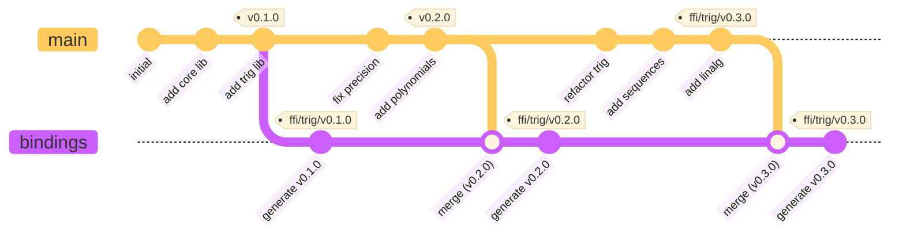
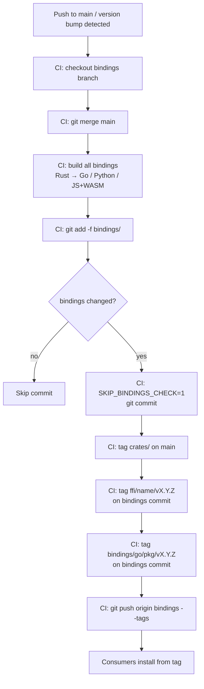

# Generated Bindings

This directory contains auto-generated language bindings for the FFI
crates. **Do not manually edit or commit files in this directory** -- a
pre-commit hook will reject the commit.

Bindings are generated by CI and committed to the `bindings` branch.
On `main`, this directory contains only this README.

## How it works

Source changes land on `main`. When a release is triggered, CI checks
out the `bindings` branch, merges `main`, generates bindings for all
target languages, and commits the result. Version tags are applied to
both branches:

- `crates/{name}/vX.Y.Z` on `main` -- marks the lib crate source commit
- `crates/ffi/{name}/vX.Y.Z` on `main` -- marks the FFI crate source commit
- `ffi/{name}/vX.Y.Z` on `bindings` -- marks the generated bindings commit
- `bindings/go/{package}/vX.Y.Z` on `bindings` -- per-module tags
  required by `go get` (must point at a commit where `go.mod` exists at
  that path)

### Branch flow



Merge commits on the `bindings` branch (e.g. "merge main (v0.2.0)") are
expected to apply cleanly because no commit on `main` should ever modify
files inside `bindings/` other than this README. A pre-commit hook
enforces this on `main`, so the only changes to generated files happen on
the `bindings` branch itself, avoiding conflicts during the merge step. 

This keeps the full history intact on the `bindings` branch while keeping `main` clean and focused on the evolution of the Rust core library.

### CI release workflow



## Consuming bindings

Install from the `bindings` branch using version tags:

```sh
# Go -- uses the per-module tag (bindings/go/{package}/vX.Y.Z)
GONOSUMCHECK=* go get github.com/<owner>/<repo>/bindings/go/uniffi_testing_core_ffi@v0.2.0

# Python -- uses the ffi/{name}/vX.Y.Z tag
pip install "git+https://github.com/<owner>/<repo>.git@ffi/core/v0.2.0#subdirectory=bindings/python/uniffi-testing-core-ffi"

# JavaScript -- pnpm supports git subdirectory installs
pnpm add "github:<owner>/<repo>#ffi/core/v0.2.0&path=bindings/js/<npm-scope>/uniffi-testing-core-ffi"
```

### Go tag requirements

Go modules in subdirectories require tags of the form
`{module-path}/v{version}` where the module path matches the directory
containing `go.mod`. These tags **must** point at a commit on the
`bindings` branch where the Go source files exist -- they cannot point
at `main` where the `bindings/go/` directory is empty.

## Local development

If you need to generate bindings locally for testing, use the Makefile
targets (`make generate-python`, `make generate-go`, `make generate-wasm-ts`).
Local changes to this directory will not be committable on `main`.
